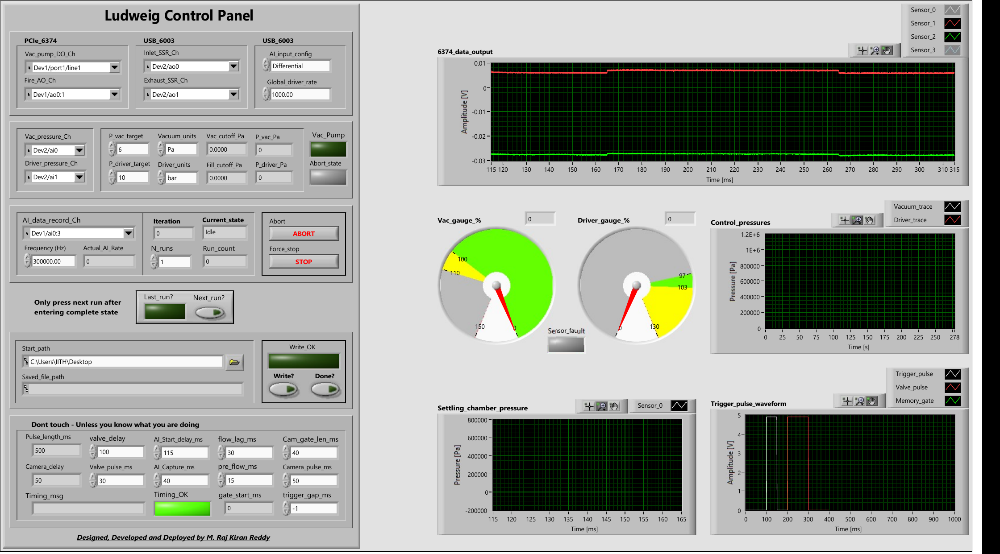
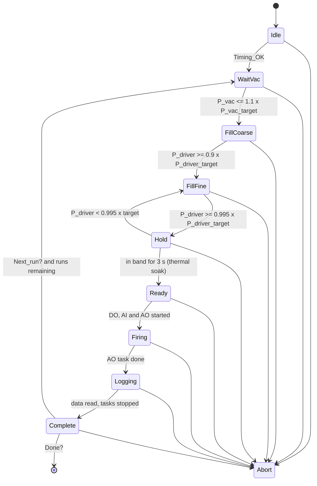

# Ludwieg Automator

[](https://doi.org/10.5281/zenodo.24187540)

LabVIEW application that runs a complete shot of a **Ludwieg tube wind tunnel** from one front panel: it evacuates the test section and dump tank, fills the driver tube to the set pressure, waits for the gas to settle, fires the fast-acting valve and the camera with a precisely timed trigger waveform, records the high-speed pressure signals and saves the shot to a text file. A state machine runs the sequence, with safety interlocks for over-pressure, gauge faults and a manual abort.

The program was written for the hardware available in our laboratory at IIT Hyderabad: the devices, sensors, channel assignments and calibration constants in this repository are ours. The logic itself is general. The same sequence, triggering scheme and interlocks apply to most Ludwieg tubes and other short-duration blowdown facilities, and everything that is specific to our setup is kept in a few clearly marked places so that it can be adapted. See [Adapting to your setup](#adapting-to-your-setup).

It is the operating software for a tunnel and nozzle designed with
[Ludwieg_Designer_and_Analyser](https://github.com/TheWa1kingDead/Ludwieg_Designer_and_Analyser) and
[MOC_Nozzle_BLC_contour_export](https://github.com/TheWa1kingDead/MOC_Nozzle_BLC_contour_export).



---

## Contents

- [Requirements](#requirements)
- [Reference hardware (our setup)](#reference-hardware-our-setup)
- [Files](#files)
- [Quick start](#quick-start)
- [Front panel](#front-panel)
- [Shot sequence (state machine)](#shot-sequence-state-machine)
- [Trigger and acquisition timing](#trigger-and-acquisition-timing)
- [Monitoring loop](#monitoring-loop)
- [Safety interlocks](#safety-interlocks)
- [Saved data file](#saved-data-file)
- [SubVIs](#subvis)
- [Adapting to your setup](#adapting-to-your-setup)
- [Limitations](#limitations)
- [How to cite](#how-to-cite)
- [Acknowledgements](#acknowledgements)
- [License](#license)

Formulas, calibration constants and the threshold values used in every state are collected in [`docs/REFERENCE.md`](docs/REFERENCE.md). Printouts of the front panel and block diagram of every VI are in [`docs/vi_prints/`](docs/vi_prints/).

---

## Requirements

- **LabVIEW 2025 Q1 (25.1)** or newer, Windows. The VIs are saved in that version; to open them in an older LabVIEW, use *File > Save for Previous Version* from 2025 Q1.
- **NI-DAQmx** driver with LabVIEW support.
- NI data acquisition hardware. Our setup is listed below; other devices can be used, see [Adapting to your setup](#adapting-to-your-setup).

---

## Reference hardware (our setup)

The VI was developed and is used with the hardware below. Your devices, sensors and channel numbers will differ; what carries over is the **role** of each channel. Two NI devices are used: a fast simultaneous-sampling board for the shot, and a low-cost USB device for the slow control loop.

| Device (default name) | Channel (default) | Front-panel control | Function |
|---|---|---|---|
| **NI PCIe-6374** (`Dev1`) | `Dev1/ai0:3` | `AI_data_record_Ch` | High-speed pressure sensors 0 to 3 during the shot (sensor 0 = settling chamber) |
| | `Dev1/ao0:1` | `Fire_AO_Ch` | Trigger waveform: `ao0` camera trigger (PCC pulse), `ao1` fast-acting valve pulse |
| | `Dev1/port1/line1` | `Vac_pump_DO_Ch` | Vacuum pump relay (digital output) |
| | `Dev1/port0/line1` | (fixed in the block diagram) | Memory gate: digital gate pulse, clocked by the AO sample clock (`/Dev1/ao/SampleClock`) so it is synchronous with the trigger waveform |
| **NI USB-6003** (`Dev2`) | `Dev2/ai0` | `Vac_pressure_Ch` | Vacuum gauge (Pirani, 0 to 10 V log output) |
| | `Dev2/ai1` | `Driver_pressure_Ch` | Driver tube pressure transducer (0 to 5 V, 14 bar gauge) |
| | `Dev2/ao0` | `Inlet_SSR_Ch` | Solid-state relay for the driver fill (inlet) valve, 0 / 10 V |
| | `Dev2/ao1` | `Exhaust_SSR_Ch` | Solid-state relay for the driver vent (exhaust) valve, 0 / 10 V |

The USB-6003 inputs use the terminal configuration set by `AI_input_config` (default **Differential**). All channel names are front-panel controls, so the wiring can be changed without editing the block diagram.

---

## Files

```
|-- src/
|   |-- 0Ludwieg_automation.vi   main VI (front panel + state machine)
|   |-- State.ctl                type-def enum of the shot states
|   |-- Shot_timing.vi           derives the gate, camera delay and waveform length, and checks the timing
|   |-- Fire_waveform.vi         builds the camera / valve trigger waveform and the memory gate
|   |-- Pirani_V_to_Pa.vi        Pirani gauge voltage -> pressure (log-linear table)
|   |-- Druck_to_Pa.vi           driver transducer voltage -> absolute pressure
|   |-- Settling_V_to_Pa.vi      high-speed sensor voltage -> pressure (baseline removed)
|   |-- Units_to_Pa.vi           Pa / kPa / bar / psi -> Pa
|   |-- Volts_to_pa.vi           ratiometric transducer (10-90% of supply) -> Pa (spare)
|   `-- Write_data_to_file.vi    saves the shot with a time column
|-- docs/
|   |-- REFERENCE.md             formulas, constants and thresholds
|   |-- front_panel.png
|   |-- block_diagram.png
|   `-- vi_prints/               LabVIEW printouts of every VI (PDF)
|-- CHANGELOG.md
|-- CITATION.cff
`-- LICENSE
```

Keep all VIs in the same folder so LabVIEW finds the subVIs.

---

## Quick start

1. Install LabVIEW 2025 Q1 and NI-DAQmx. Check the device names in NI MAX (`Dev1`, `Dev2`) and rename them or change the channel controls to match.
2. Open `src/0Ludwieg_automation.vi`.
3. Set the targets: `P_vac_target` with `Vacuum_units`, and `P_driver_target` with `Driver_units`.
4. Set `N_runs`, the number of shots in the series.
5. Set the shot timing in the *Dont touch* group: `Frequency (Hz)`, `AI_Start_delay_ms`, `AI_Capture_ms`, `valve_delay`, `Valve_pulse_ms`, `flow_lag_ms`, `pre_flow_ms`, `Cam_gate_len_ms`, `trigger_gap_ms`, `Camera_pulse_ms`. `Pulse_length_ms`, `Camera_delay` and `gate_start_ms` are computed by `Shot_timing.vi`. Check that `Timing_OK` is lit and `Timing_msg` is empty, and check the **Trigger_pulse_waveform** graph.
6. Set `Start_path` to the folder where shots should be saved.
7. **Run** the VI. The sequence runs on its own: vacuum, coarse fill, fine fill, hold, fire, record.
8. When `Current_state` shows **Complete**: if more runs remain, press **Next_run?** to start the next shot (it goes back to WaitVac). Only press it once the state is Complete. After the last run (`Last_run?` lit), press **Write?** to save the shot (a file dialog opens in `Start_path`), then **Done?** to finish.

**ABORT** stops the sequence and closes both SSR valves. **STOP** (`Force_stop`) ends the VI; all outputs are set to a safe state and the DAQmx tasks are cleared.

---

## Front panel

| Group | Controls / indicators | Default |
|---|---|---|
| Channels | `Vac_pump_DO_Ch`, `Fire_AO_Ch`, `Inlet_SSR_Ch`, `Exhaust_SSR_Ch`, `Vac_pressure_Ch`, `Driver_pressure_Ch`, `AI_data_record_Ch`, `AI_input_config` | see table above |
| Monitoring rate | `Global_driver_rate` | 1000 Hz |
| Vacuum | `P_vac_target`, `Vacuum_units`; indicators `Vac_cutoff_Pa`, `P_vac_Pa`, `Vac_gauge_%`, `Vac_Pump` | 6 Pa |
| Driver | `P_driver_target`, `Driver_units`; indicators `Fill_cutoff_Pa`, `P_driver_Pa`, `Driver_gauge_%` | 10 bar |
| Acquisition | `Frequency (Hz)`, `AI_Start_delay_ms`, `AI_Capture_ms`; indicator `Actual_AI_Rate` | 300 kHz, 115 ms, 40 ms |
| Shot timing (*Dont touch* group) | `valve_delay`, `Valve_pulse_ms`, `flow_lag_ms`, `pre_flow_ms`, `Cam_gate_len_ms`, `trigger_gap_ms`, `Camera_pulse_ms` | 100, 30, 30, 15, 40, -1, 50 ms |
| Shot timing (computed) | indicators `Pulse_length_ms`, `Camera_delay`, `gate_start_ms`, `Timing_OK`, `Timing_msg` | |
| Runs | `N_runs`, `Next_run?`; indicators `Run_count`, `Last_run?` | 1 run |
| Saving | `Start_path`, `Write?`, `Done?`; indicators `Write_OK`, `Saved_file_path` | Desktop |
| Status | `Current_state`, `Iteration`, `Abort_state`, `Sensor_fault` | |
| Buttons | `ABORT`, `STOP` (`Force_stop`) | |
| Graphs | `Control_pressures` (vacuum and driver vs time), `6374_data_output` (raw sensor voltages), `Settling_chamber_pressure`, `Trigger_pulse_waveform` (trigger pulse, valve pulse and memory gate) | |

The two dials show the measured pressure as a percentage of its target.

---

## Shot sequence (state machine)

The main loop runs every **100 ms**. The current state is held in a shift register of type `State.ctl`.



Any state goes to **Abort** when the abort condition is true (see [Safety interlocks](#safety-interlocks)).

| State | Inlet SSR | Exhaust SSR | Vacuum pump | What happens | Leaves when |
|---|---|---|---|---|---|
| **Idle** | off | off | on | Start of the sequence. The shot timing is checked first; if `Timing_OK` is false the state goes to Abort | immediately, to WaitVac (or Abort) |
| **WaitVac** | off | off | on | Test section and dump tank are pumped down. `Vac_cutoff_Pa = 1.1 x P_vac_target` | `P_vac <= Vac_cutoff_Pa` |
| **FillCoarse** | on (10 V) | off | on | Driver filled continuously. `Fill_cutoff_Pa = 0.9 x P_driver_target` | `P_driver >= Fill_cutoff_Pa` |
| **FillFine** | pulsed | off | on | Inlet valve opened 150 ms in every 1000 ms to approach the target slowly | `P_driver >= 0.995 x P_driver_target` |
| **Hold** | off | pulsed if high | on | Pressure kept in the band 0.995 to 1.02 x target. Above the band the exhaust valve is pulsed (150 ms in 1000 ms); below it the state returns to FillFine. A 3 s thermal-soak timer runs while the pressure is in band and restarts when it leaves | in band for `thermal_soak_ms` = 3000 ms |
| **Ready** | off | off | **off** | The trigger waveform is written to the AO task and the memory gate to the DO task. On the last run (`Last_run?`) the waveform includes the camera trigger pulse, which completes the recording and closes the cine file; earlier runs use the waveform without it. The DO and AI tasks are started (both waiting for the AO), then the AO task is started | next iteration |
| **Firing** | off | off | off | Camera and valve pulses are output; AI records after the start delay | AO task done |
| **Logging** | off | off | off | All AI samples are read from the PCIe-6374, tasks are stopped | data read |
| **Complete** | off | off | on | If `Run_count < N_runs`, **Next_run?** increments `Run_count` and returns to WaitVac for the next shot. Otherwise `Write?` and `Done?` are enabled: **Write?** saves the shot, **Done?** finishes | `Next_run?` or `Done?` |
| **Abort** | off | off | on | Valves closed; the VI stays in Abort until **STOP** | STOP |

The vacuum pump is switched off during **Ready**, **Firing** and **Logging** so that pump vibration and electrical noise do not reach the measurements.

---

## Trigger and acquisition timing

The shot timing is set from the physical events, not from absolute times. `Shot_timing.vi` takes the valve timing, the flow delays and the acquisition window, and derives the rest:

```
gate_start_ms   = valve_delay + flow_lag_ms - pre_flow_ms
gate_end        = gate_start_ms + Cam_gate_len_ms
Camera_delay    = gate_end + trigger_gap_ms
Pulse_length_ms = max(valve_delay + Valve_pulse_ms,
                      Camera_delay + Camera_pulse_ms,
                      AI_Start_delay_ms + AI_Capture_ms) + tail_ms     (tail_ms = 50)
```

- `flow_lag_ms`: time from the valve pulse to the start of the flow in the test section.
- `pre_flow_ms`: how early the gate opens before the flow arrives.
- `Cam_gate_len_ms`: length of the memory gate.
- `trigger_gap_ms`: offset of the camera trigger from the end of the gate (negative: before the end).

`Timing_OK` is true only when all of these hold; otherwise `Timing_msg` says what to change and the VI does not start (Idle goes to Abort):

| Code | Condition | Message |
|---|---|---|
| 1 | `Cam_gate_len_ms <= 0` | gate_len_ms must be > 0 |
| 2 | `gate_start_ms < 0` | Gate starts before t=0, reduce pre_flow_ms |
| 3 | `AI_Start_delay_ms > gate_start_ms` | AI starts after the gate, reduce Start_delay_ms |
| 4 | `AI_Start_delay_ms + AI_Capture_ms < gate_end` | AI ends before the gate ends, increase Capture_time_ms |
| 5 | `Pulse_length_ms x rate / 1000 > 4000` | Waveform too long for AO memory, shorten timings |

When the AO task starts, `Fire_waveform.vi` outputs, at `Global_driver_rate` samples per second with an amplitude of 4.9 V:

- **`ao0` camera (PCC) pulse**: width `Camera_pulse_ms`, delayed by `Camera_delay`. It is output only when `Camera_trigger_on` is true (the waveform "with trigger", used on the last run to complete the recording and close the cine file); otherwise this channel stays at 0 V.
- **`ao1` valve pulse**: width `Valve_pulse_ms`, delayed by `valve_delay`.
- **Memory gate** (digital, `Dev1/port0/line1`): high from `gate_start_ms` for `Cam_gate_len_ms`. It is clocked by the AO sample clock, so it is sample-synchronous with the two analog pulses. On the **Trigger_pulse_waveform** graph it is drawn at 4 V for visibility.

The PCIe-6374 AI task uses the AO start trigger (`/Dev1/ao/StartTrigger`) with a start delay of `AI_Start_delay_ms`, then records `AI_Capture_ms` of data at `Frequency (Hz)` on four channels (finite samples, `N = Frequency x AI_Capture_ms / 1000`).

```
t = 0                                AO start trigger (waveform begins)
t = valve_delay                      valve pulse (Valve_pulse_ms wide)
t = AI_Start_delay_ms                AI recording starts (before the gate)
t = gate_start_ms                    memory gate opens
t = gate_end                         memory gate closes
t = Camera_delay                     camera pulse (Camera_pulse_ms wide)
t = AI_Start_delay_ms + AI_Capture_ms   AI recording ends (after the gate)
t = Pulse_length_ms                  waveform ends
```

Always check the **Trigger_pulse_waveform** graph before a shot: it shows the waveform and gate exactly as they will be output.

`Actual_AI_Rate` shows the sample rate the device actually uses (the PCIe-6374 rounds the requested rate to its timebase, e.g. 300 kHz becomes 300.3 kHz). The time axes and the saved time column use this value.

---

## Monitoring loop

The USB-6003 samples the vacuum gauge and the driver transducer continuously at `Global_driver_rate` (1000 Hz, 50 000-sample buffer). Every loop iteration reads all available samples, averages each channel and converts it to pressure:

- vacuum: `Pirani_V_to_Pa.vi`
- driver: `Druck_to_Pa.vi`

The targets are converted to Pa with `Units_to_Pa.vi` from the selected units (Pa, kPa, bar, psi). Both pressures are plotted on **Control_pressures**.

---

## Safety interlocks

`Abort_state` is true when any of these is true:

| Condition | Source |
|---|---|
| **ABORT** button pressed | operator |
| Vacuum gauge fault (output below 1.25 V) | `Pirani_V_to_Pa.vi`, `Sensor_fault` |
| Driver over-pressure, `P_driver > 1.2 x P_driver_target` | `Driver_abort_logic` |

In the Abort state both SSR valves are closed. When the VI stops (STOP button), the vacuum pump output is set low, the AO channels are set to 0 V, the SSR outputs are set to 0 V, and all DAQmx tasks are stopped and cleared before errors are reported.

These are software interlocks. Keep the mechanical safety devices of the facility (relief valve, burst disc) in place.

---

## Saved data file

`Write_data_to_file.vi` opens a file dialog in `Start_path` with a suggested name ending in `_NI6374.txt` and writes a tab-separated text file:

| Column | Content | Units |
|---|---|---|
| 1 | time from the AO start trigger, `t = AI_Start_delay_ms + i x 1000 / Actual_AI_Rate` | ms |
| 2 to 5 | sensors 0 to 3 (`AI_data_record_Ch`) | V (raw) |

Values are written with six decimals (`%.6f`). The raw voltages are saved so that the calibration can be applied, or corrected, afterwards.

---

## SubVIs

| VI | Inputs | Outputs | Function |
|---|---|---|---|
| `Shot_timing.vi` | rate, start_delay_ms, capture_time_ms, valve_delay, valve_pulse_ms, camera_pulse_ms, flow_lag_ms, pre_flow_ms, gate_len_ms, trigger_gap_ms, tail_ms | gate_start_ms, camera_delay, pulse_length_ms, Timing_OK, fail_code, Timing_msg | Derives the gate, camera delay and waveform length from the flow timing and checks them (codes 1 to 5) |
| `Fire_waveform.vi` | rate, pulse_length_ms, camera_delay, camera_pulse_ms, valve_delay, valve_pulse_ms, amplitude, gate_start_ms, gate_len_ms, Camera_trigger_on | 2 x N waveform, Gate (U32 digital samples), N | Camera and valve trigger pulses, and the memory gate. `Camera_trigger_on` = false sets the camera channel to 0 V |
| `Pirani_V_to_Pa.vi` | V_in | P_Pa, P_mbar, Sensor_fault, At_atm | Interpolates log10(P/mbar) from a 55-point voltage table (1e-3 to 1000 mbar). Fault below 1.25 V, atmosphere at 9.99 V or more |
| `Druck_to_Pa.vi` | V_in, V_FS, P_FS_gauge_Pa, P_ambient_Pa, V_zero | P_abs_Pa, P_gauge_Pa | Linear gauge transducer with zero offset, plus ambient pressure |
| `Settling_V_to_Pa.vi` | V_array, Actual_AI_Rate, baseline_ms, sens_mV_per_psi, gain | P_Pa_array | Removes the mean of the first `baseline_ms`, converts mV/psi sensitivity and amplifier gain to Pa |
| `Units_to_Pa.vi` | Value, Units | P_Pa | Pa, kPa, bar, psi |
| `Volts_to_pa.vi` | V_in, V_supply, P_min_Pa, P_max_Pa | P_Pa, Out_of_range | Ratiometric transducer, 10 to 90% of supply. Not used by the main VI; kept for other sensors |
| `Write_data_to_file.vi` | shot_data, Actual_AI_Rate, AI_Start_delay_ms, start_path | Write_OK, file_path | Saves the shot with a time column |

Equations and constants: [`docs/REFERENCE.md`](docs/REFERENCE.md).

---

## Adapting to your setup

The VI is built around **roles**, not around specific devices. Any facility that has the same roles can use the same logic.

**What is general and normally stays as it is**

- The shot sequence: evacuate, fill coarse, fill fine, hold and soak, fire, record, save.
- Hardware-timed firing: one analog output waveform carries the valve and camera pulses, and its start trigger starts the high-speed recording after a set delay. This keeps the valve, the camera and the data on one time base.
- The interlocks (manual abort, gauge fault, over-pressure) and the safe shutdown of every output.
- Switching the vacuum pump off during the shot, and saving raw voltages with a time column.

**What is specific to our setup and has to be changed**

| Role | Our hardware | What your hardware needs |
|---|---|---|
| High-speed recording | PCIe-6374, 4 channels at 300 kHz | Any DAQmx device with a hardware start trigger and start delay; set `AI_data_record_Ch` and `Frequency (Hz)` |
| Trigger waveform | PCIe-6374 `ao0:1`, 4.9 V pulses | Two analog (or digital) outputs on the **same** device as the recording, so the AI can use its start trigger; set `Fire_AO_Ch` and the pulse amplitude your valve driver and camera expect |
| Memory gate | PCIe-6374 `port0/line1`, clocked by the AO sample clock | A digital output that can use the AO sample clock as its clock; change the channel constant on the block diagram |
| Vacuum pump | PCIe-6374 digital line | Any digital output driving the pump relay; set `Vac_pump_DO_Ch` |
| Driver fill and vent valves | USB-6003 `ao0:1` (0 / 10 V into SSRs) | Any analog or digital outputs that switch your valve drivers; set `Inlet_SSR_Ch`, `Exhaust_SSR_Ch` |
| Vacuum gauge | Pirani gauge, 0 to 10 V log output | Replace the table in `Pirani_V_to_Pa.vi` with your gauge's voltage-pressure curve and fault limits |
| Driver pressure | 14 bar gauge transducer, 0 to 5 V | Set full scale, zero and ambient pressure in `Druck_to_Pa.vi`, or use `Volts_to_pa.vi` for a ratiometric sensor |
| Settling-chamber pressure | piezoelectric sensor, 1.26 mV/psi | Set sensitivity, gain and baseline window in `Settling_V_to_Pa.vi` |

**Thresholds to review for your tunnel**

The fill fractions (0.9, 0.995), hold band (0.995 to 1.02), vacuum margin (1.1), over-pressure limit (1.2), valve pulse during fine fill and venting (150 ms in 1000 ms) and soak time (3000 ms) were chosen for our driver tube volume and valves. A larger driver or faster valves may need different values. They are constants in the corresponding cases of the state machine and are listed in [`docs/REFERENCE.md`](docs/REFERENCE.md).

**Other software or hardware**

Nothing in the logic depends on LabVIEW itself. The state table in [Shot sequence](#shot-sequence-state-machine), the timing in [Trigger and acquisition timing](#trigger-and-acquisition-timing) and the formulas in [`docs/REFERENCE.md`](docs/REFERENCE.md) are enough to reimplement it, for example in Python with `nidaqmx`, or with another vendor's hardware.

---

## Limitations

- The ambient pressure in `Druck_to_Pa.vi` is a fixed constant (94 kPa). Update it, or measure it, if the barometric pressure changes significantly.
- Pressure control is on/off (solenoid valves through SSRs), so the final driver pressure is set to the hold band, not to an exact value.
- The over-pressure interlock uses the averaged driver pressure from the 100 ms loop; it is not a substitute for a relief valve.
- The VI has been tested only with our hardware. Other devices may need changes to the channel ranges, terminal configuration and timing.

---

## How to cite

This software is archived on Zenodo: [doi:10.5281/zenodo.24187540](https://doi.org/10.5281/zenodo.24187540). If you use it, please cite it (GitHub **"Cite this repository"** uses [`CITATION.cff`](CITATION.cff)).

```bibtex
@software{reddy_ludwieg_automator_2026,
  author  = {Reddy, MRK},
  title   = {{Ludwieg Automator}: LabVIEW automation of a Ludwieg tube
             wind tunnel (vacuum, driver fill, firing and data acquisition)},
  year    = {2026},
  version = {1.1.0},
  doi     = {10.5281/zenodo.24187540},
  url     = {https://github.com/TheWa1kingDead/Ludwieg_Automator}
}
```

---

## Acknowledgements

This software was developed by MRK Reddy under the guidance of **Prof. S.K. Karthick**, Department of Mechanical and Aerospace Engineering, Indian Institute of Technology Hyderabad, India.

---

## License

Released under the [MIT License](LICENSE).

## Contact

**MRK Reddy** · ORCID [0009-0006-8420-6672](https://orcid.org/0009-0006-8420-6672) · GitHub [@TheWa1kingDead](https://github.com/TheWa1kingDead)

Bug reports and suggestions: [Issues](../../issues).
