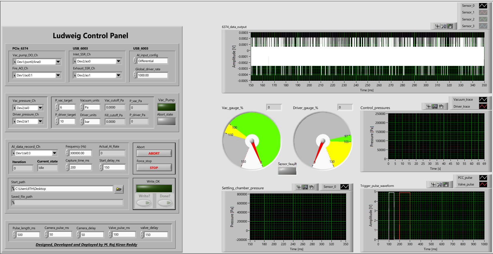
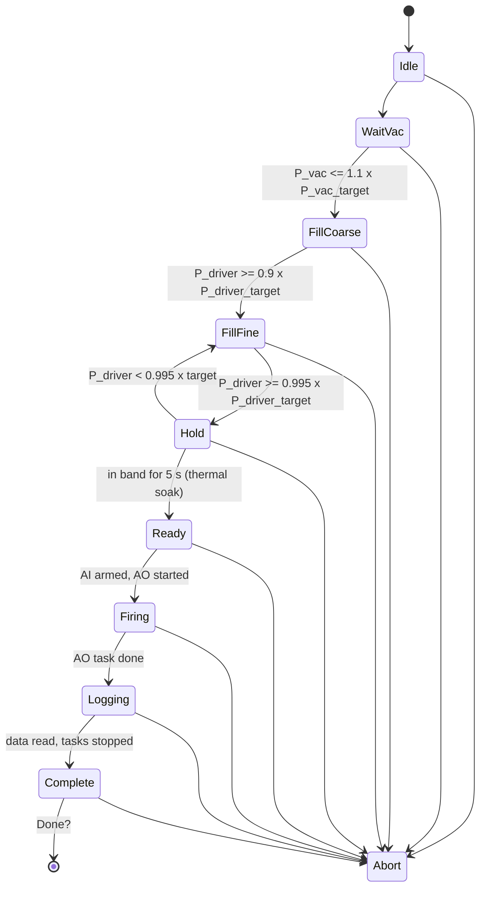

# Ludwieg Automator

LabVIEW application that runs a complete shot of a **Ludwieg tube wind tunnel** from one front panel: it evacuates the test section and dump tank, fills the driver tube to the set pressure, waits for the gas to settle, fires the fast-acting valve and the camera with a precisely timed trigger waveform, records the high-speed pressure signals and saves the shot to a text file. A state machine runs the sequence, with safety interlocks for over-pressure, gauge faults and a manual abort.

It is the operating software for a tunnel and nozzle designed with
[Ludwieg_Designer_and_Analyser](https://github.com/TheWa1kingDead/Ludwieg_Designer_and_Analyser) and
[MOC_Nozzle_BLC_contour_export](https://github.com/TheWa1kingDead/MOC_Nozzle_BLC_contour_export).



---

## Contents

- [Requirements](#requirements)
- [Hardware and wiring](#hardware-and-wiring)
- [Files](#files)
- [Quick start](#quick-start)
- [Front panel](#front-panel)
- [Shot sequence (state machine)](#shot-sequence-state-machine)
- [Trigger and acquisition timing](#trigger-and-acquisition-timing)
- [Monitoring loop](#monitoring-loop)
- [Safety interlocks](#safety-interlocks)
- [Saved data file](#saved-data-file)
- [SubVIs](#subvis)
- [Adapting to another facility](#adapting-to-another-facility)
- [Limitations](#limitations)
- [How to cite](#how-to-cite)
- [Acknowledgements](#acknowledgements)
- [License](#license)

Formulas, calibration constants and the threshold values used in every state are collected in [`docs/REFERENCE.md`](docs/REFERENCE.md). Printouts of the front panel and block diagram of every VI are in [`docs/vi_prints/`](docs/vi_prints/).

---

## Requirements

- **LabVIEW 2025 Q1 (25.1)** or newer, Windows. The VIs are saved in that version; to open them in an older LabVIEW, use *File > Save for Previous Version* from 2025 Q1.
- **NI-DAQmx** driver with LabVIEW support.
- NI data acquisition hardware as listed below (or equivalent devices, see [Adapting to another facility](#adapting-to-another-facility)).

---

## Hardware and wiring

Two NI devices are used: a fast simultaneous-sampling board for the shot, and a low-cost USB device for the slow control loop.

| Device (default name) | Channel (default) | Front-panel control | Function |
|---|---|---|---|
| **NI PCIe-6374** (`Dev1`) | `Dev1/ai0:3` | `AI_data_record_Ch` | High-speed pressure sensors 0 to 3 during the shot (sensor 0 = settling chamber) |
| | `Dev1/ao0:1` | `Fire_AO_Ch` | Trigger waveform: `ao0` camera trigger (PCC pulse), `ao1` fast-acting valve pulse |
| | `Dev1/port0/line0` | `Vac_pump_DO_Ch` | Vacuum pump relay (digital output) |
| **NI USB-6003** (`Dev2`) | `Dev2/ai0` | `Vac_pressure_Ch` | Vacuum gauge (Pirani, 0 to 10 V log output) |
| | `Dev2/ai1` | `Driver_pressure_Ch` | Driver tube pressure transducer (0 to 5 V, 14 bar gauge) |
| | `Dev2/ao0` | `Inlet_SSR_Ch` | Solid-state relay for the driver fill (inlet) valve, 0 / 10 V |
| | `Dev2/ao1` | `Exhaust_SSR_Ch` | Solid-state relay for the driver vent (exhaust) valve, 0 / 10 V |

The USB-6003 inputs use the terminal configuration set by `AI_input_config` (default **Differential**). All channel names are front-panel controls, so the wiring can be changed without editing the block diagram.

---

## Files

```
|-- src/
|   |-- 0Ludwieg_automation.vi   main VI (front panel + state machine)
|   |-- State.ctl                type-def enum of the shot states
|   |-- Fire_waveform.vi         builds the 2-channel camera / valve trigger waveform
|   |-- Pirani_V_to_Pa.vi        Pirani gauge voltage -> pressure (log-linear table)
|   |-- Druck_to_Pa.vi           driver transducer voltage -> absolute pressure
|   |-- Settling_V_to_Pa.vi      high-speed sensor voltage -> pressure (baseline removed)
|   |-- Units_to_Pa.vi           Pa / kPa / bar / psi -> Pa
|   |-- Volts_to_pa.vi           ratiometric transducer (10-90% of supply) -> Pa (spare)
|   `-- Write_data_to_file.vi    saves the shot with a time column
|-- docs/
|   |-- REFERENCE.md             formulas, constants and thresholds
|   |-- front_panel.png
|   |-- block_diagram.png
|   `-- vi_prints/               LabVIEW printouts of every VI (PDF)
|-- CHANGELOG.md
|-- CITATION.cff
`-- LICENSE
```

Keep all VIs in the same folder so LabVIEW finds the subVIs.

---

## Quick start

1. Install LabVIEW 2025 Q1 and NI-DAQmx. Check the device names in NI MAX (`Dev1`, `Dev2`) and rename them or change the channel controls to match.
2. Open `src/0Ludwieg_automation.vi`.
3. Set the targets: `P_vac_target` with `Vacuum_units`, and `P_driver_target` with `Driver_units`.
4. Set the shot timing: `Frequency (Hz)`, `Capture_time_ms`, `Start_delay_ms`, and the trigger pulse settings (`Pulse_length_ms`, `Camera_delay`, `Camera_pulse_ms`, `valve_delay`, `Valve_pulse_ms`). Check the **Trigger_pulse_waveform** graph.
5. Set `Start_path` to the folder where shots should be saved.
6. **Run** the VI. The sequence runs on its own: vacuum, coarse fill, fine fill, hold, fire, record.
7. When `Current_state` shows **Complete**, the **Write?** and **Done?** buttons are enabled. Press **Write?** to save the shot (a file dialog opens in `Start_path`), then **Done?** to finish.

**ABORT** stops the sequence and closes both SSR valves. **STOP** (`Force_stop`) ends the VI; all outputs are set to a safe state and the DAQmx tasks are cleared.

---

## Front panel

| Group | Controls / indicators | Default |
|---|---|---|
| Channels | `Vac_pump_DO_Ch`, `Fire_AO_Ch`, `Inlet_SSR_Ch`, `Exhaust_SSR_Ch`, `Vac_pressure_Ch`, `Driver_pressure_Ch`, `AI_data_record_Ch`, `AI_input_config` | see table above |
| Monitoring rate | `Global_driver_rate` | 1000 Hz |
| Vacuum | `P_vac_target`, `Vacuum_units`; indicators `Vac_cutoff_Pa`, `P_vac_Pa`, `Vac_gauge_%`, `Vac_Pump` | 6 Pa |
| Driver | `P_driver_target`, `Driver_units`; indicators `Fill_cutoff_Pa`, `P_driver_Pa`, `Driver_gauge_%` | 10 bar |
| Acquisition | `Frequency (Hz)`, `Capture_time_ms`, `Start_delay_ms`; indicator `Actual_AI_Rate` | 300 kHz, 200 ms, 150 ms |
| Trigger | `Pulse_length_ms`, `Camera_pulse_ms`, `Camera_delay`, `Valve_pulse_ms`, `valve_delay` | 500, 50, 50, 100, 150 ms |
| Saving | `Start_path`, `Write?`, `Done?`; indicators `Write_OK`, `Saved_file_path` | Desktop |
| Status | `Current_state`, `Iteration`, `Abort_state`, `Sensor_fault` | |
| Buttons | `ABORT`, `STOP` (`Force_stop`) | |
| Graphs | `Control_pressures` (vacuum and driver vs time), `6374_data_output` (raw sensor voltages), `Settling_chamber_pressure`, `Trigger_pulse_waveform` | |

The two dials show the measured pressure as a percentage of its target.

---

## Shot sequence (state machine)

The main loop runs every **100 ms**. The current state is held in a shift register of type `State.ctl`.



Any state goes to **Abort** when the abort condition is true (see [Safety interlocks](#safety-interlocks)).

| State | Inlet SSR | Exhaust SSR | Vacuum pump | What happens | Leaves when |
|---|---|---|---|---|---|
| **Idle** | off | off | on | Start of the sequence | immediately, to WaitVac |
| **WaitVac** | off | off | on | Test section and dump tank are pumped down. `Vac_cutoff_Pa = 1.1 x P_vac_target` | `P_vac <= Vac_cutoff_Pa` |
| **FillCoarse** | on (10 V) | off | on | Driver filled continuously. `Fill_cutoff_Pa = 0.9 x P_driver_target` | `P_driver >= Fill_cutoff_Pa` |
| **FillFine** | pulsed | off | on | Inlet valve opened 150 ms in every 1000 ms to approach the target slowly | `P_driver >= 0.995 x P_driver_target` |
| **Hold** | off | pulsed if high | on | Pressure kept in the band 0.995 to 1.02 x target. Above the band the exhaust valve is pulsed (150 ms in 1000 ms); below it the state returns to FillFine. A 5 s thermal-soak timer runs while the pressure is in band and restarts when it leaves | in band for `thermal_soak_ms` = 5000 ms |
| **Ready** | off | off | **off** | The shot waveform is written to the AO task, the AI task is started (waiting for the AO start trigger), then the AO task is started | next iteration |
| **Firing** | off | off | off | Camera and valve pulses are output; AI records after the start delay | AO task done |
| **Logging** | off | off | off | All AI samples are read from the PCIe-6374, tasks are stopped | data read |
| **Complete** | off | off | on | `Write?` and `Done?` enabled. **Write?** saves the shot; **Done?** finishes the run | `Done?` |
| **Abort** | off | off | on | Valves closed; the VI stays in Abort until **STOP** | STOP |

The vacuum pump is switched off during **Ready**, **Firing** and **Logging** so that pump vibration and electrical noise do not reach the measurements.

---

## Trigger and acquisition timing

When the AO task starts it outputs a two-channel waveform of length `Pulse_length_ms`, built by `Fire_waveform.vi` at `Global_driver_rate` samples per second with an amplitude of 4.9 V:

- **`ao0` camera (PCC) pulse**: width `Camera_pulse_ms`, delayed by `Camera_delay`.
- **`ao1` valve pulse**: width `Valve_pulse_ms`, delayed by `valve_delay`.

The PCIe-6374 AI task uses the AO start trigger (`/Dev1/ao/StartTrigger`) with a start delay of `Start_delay_ms`, then records `Capture_time_ms` of data at `Frequency (Hz)` on four channels (finite samples, `N = Frequency x Capture_time_ms / 1000`).

```
t = 0                 AO start trigger (waveform begins)
t = Camera_delay      camera pulse  (Camera_pulse_ms wide)
t = valve_delay       valve pulse   (Valve_pulse_ms wide)
t = Start_delay_ms    AI recording starts
t = Start_delay_ms + Capture_time_ms   AI recording ends
t = Pulse_length_ms   waveform ends
```

The timing must satisfy

```
Start_delay_ms + Capture_time_ms < Pulse_length_ms
```

so that the AI record ends before the AO task is done. Always check the **Trigger_pulse_waveform** graph before a shot: it shows the waveform exactly as it will be output.

`Actual_AI_Rate` shows the sample rate the device actually uses (the PCIe-6374 rounds the requested rate to its timebase, e.g. 300 kHz becomes 300.3 kHz). The time axes and the saved time column use this value.

---

## Monitoring loop

The USB-6003 samples the vacuum gauge and the driver transducer continuously at `Global_driver_rate` (1000 Hz, 50 000-sample buffer). Every loop iteration reads all available samples, averages each channel and converts it to pressure:

- vacuum: `Pirani_V_to_Pa.vi`
- driver: `Druck_to_Pa.vi`

The targets are converted to Pa with `Units_to_Pa.vi` from the selected units (Pa, kPa, bar, psi). Both pressures are plotted on **Control_pressures**.

---

## Safety interlocks

`Abort_state` is true when any of these is true:

| Condition | Source |
|---|---|
| **ABORT** button pressed | operator |
| Vacuum gauge fault (output below 1.25 V) | `Pirani_V_to_Pa.vi`, `Sensor_fault` |
| Driver over-pressure, `P_driver > 1.2 x P_driver_target` | `Driver_abort_logic` |

In the Abort state both SSR valves are closed. When the VI stops (STOP button), the vacuum pump output is set low, the AO channels are set to 0 V, the SSR outputs are set to 0 V, and all DAQmx tasks are stopped and cleared before errors are reported.

These are software interlocks. Keep the mechanical safety devices of the facility (relief valve, burst disc) in place.

---

## Saved data file

`Write_data_to_file.vi` opens a file dialog in `Start_path` with a suggested name ending in `_NI6374.txt` and writes a tab-separated text file:

| Column | Content | Units |
|---|---|---|
| 1 | time from the AO start trigger, `t = Start_delay_ms + i x 1000 / Actual_AI_Rate` | ms |
| 2 to 5 | sensors 0 to 3 (`AI_data_record_Ch`) | V (raw) |

Values are written with six decimals (`%.6f`). The raw voltages are saved so that the calibration can be applied, or corrected, afterwards.

---

## SubVIs

| VI | Inputs | Outputs | Function |
|---|---|---|---|
| `Fire_waveform.vi` | rate, pulse_length_ms, camera_delay, camera_pulse_ms, valve_delay, valve_pulse_ms, amplitude | 2 x N waveform | Camera and valve trigger pulses |
| `Pirani_V_to_Pa.vi` | V_in | P_Pa, P_mbar, Sensor_fault, At_atm | Interpolates log10(P/mbar) from a 55-point voltage table (1e-3 to 1000 mbar). Fault below 1.25 V, atmosphere at 9.99 V or more |
| `Druck_to_Pa.vi` | V_in, V_FS, P_FS_gauge_Pa, P_ambient_Pa, V_zero | P_abs_Pa, P_gauge_Pa | Linear gauge transducer with zero offset, plus ambient pressure |
| `Settling_V_to_Pa.vi` | V_array, Actual_AI_Rate, baseline_ms, sens_mV_per_psi, gain | P_Pa_array | Removes the mean of the first `baseline_ms`, converts mV/psi sensitivity and amplifier gain to Pa |
| `Units_to_Pa.vi` | Value, Units | P_Pa | Pa, kPa, bar, psi |
| `Volts_to_pa.vi` | V_in, V_supply, P_min_Pa, P_max_Pa | P_Pa, Out_of_range | Ratiometric transducer, 10 to 90% of supply. Not used by the main VI; kept for other sensors |
| `Write_data_to_file.vi` | shot_data, Actual_AI_Rate, Start_delay_ms, start_path | Write_OK, file_path | Saves the shot with a time column |

Equations and constants: [`docs/REFERENCE.md`](docs/REFERENCE.md).

---

## Adapting to another facility

- **Channels and devices**: change the channel controls on the front panel. A different fast board works if it supports an AO start trigger and a hardware AI start delay.
- **Sensors**: change the constants in `Druck_to_Pa.vi` (full scale, zero, ambient pressure), the voltage table in `Pirani_V_to_Pa.vi`, and the sensitivity and gain in `Settling_V_to_Pa.vi`.
- **Thresholds**: the fill fractions (0.9, 0.995), hold band (0.995 to 1.02), vacuum margin (1.1), over-pressure limit (1.2), fine-fill pulse (150 ms in 1000 ms) and soak time (5000 ms) are constants in the corresponding cases of the state machine. They are listed in [`docs/REFERENCE.md`](docs/REFERENCE.md).

---

## Limitations

- The ambient pressure in `Druck_to_Pa.vi` is a fixed constant (94 kPa). Update it, or measure it, if the barometric pressure changes significantly.
- Pressure control is on/off (solenoid valves through SSRs), so the final driver pressure is set to the hold band, not to an exact value.
- The over-pressure interlock uses the averaged driver pressure from the 100 ms loop; it is not a substitute for a relief valve.
- The VI has been used with the hardware listed above. Other devices may need changes to the channel ranges and timing.

---

## How to cite

If you use this software, please cite it (GitHub **"Cite this repository"** uses [`CITATION.cff`](CITATION.cff)).

```bibtex
@software{reddy_ludwieg_automator_2026,
  author  = {Reddy, MRK},
  title   = {{Ludwieg Automator}: LabVIEW automation of a Ludwieg tube
             wind tunnel (vacuum, driver fill, firing and data acquisition)},
  year    = {2026},
  version = {1.0.0},
  url     = {https://github.com/TheWa1kingDead/Ludwieg_Automator}
}
```

---

## Acknowledgements

This software was developed by MRK Reddy under the guidance of **Prof. S.K. Karthick**, Department of Mechanical and Aerospace Engineering, Indian Institute of Technology Hyderabad, India.

---

## License

Released under the [MIT License](LICENSE).

## Contact

**MRK Reddy** · ORCID [0009-0006-8420-6672](https://orcid.org/0009-0006-8420-6672) · GitHub [@TheWa1kingDead](https://github.com/TheWa1kingDead)

Bug reports and suggestions: [Issues](../../issues).
